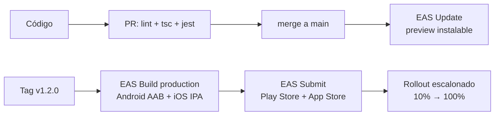

# 🚀 Guía DevOps y Seguridad · FitJournal

---

## 1. Entorno local de desarrollo

### Requisitos

| Requisito | Versión |
|---|---|
| Node.js | 20 LTS o superior |
| npm | 10+ |
| Cuenta Expo | gratuita (expo.dev) |
| Git | 2.x |
| Móvil | Expo Go (pruebas) o dev build (módulos nativos) |

### Arranque

```bash
npm install
npx expo start          # QR → Expo Go en el dispositivo
npm test                # Jest
npx tsc --noEmit        # typecheck
```

### Comandos EAS

```bash
npm install -g eas-cli
eas login
eas build --profile preview          # build de prueba instalable
eas build --profile production       # build para tienda
eas submit --platform all            # subir a tiendas
eas update --branch main --message "fix: ..."   # parche OTA
```

---

## 2. Configuración Expo (`app.config.ts`)

- **Permisos:** solo `CAMERA` y `PHOTO_LIBRARY` (solicitados en primer uso real, no en instalación).
- **Plugins:** expo-sqlite, expo-image-picker, expo-av, expo-local-authentication, expo-notifications.
- **Versioning:** semver en `version` + `android.versionCode` / `ios.buildNumber` (EAS los autoincrementa).

---

## 3. CI/CD — GitHub Actions

### 3.1 Pipeline de PR (`.github/workflows/ci.yml`)

```yaml
name: CI
on: [pull_request]
jobs:
  quality:
    runs-on: ubuntu-latest
    steps:
      - uses: actions/checkout@v4
      - uses: actions/setup-node@v4
        with: { node-version: 20, cache: npm }
      - run: npm ci
      - run: npm run lint
      - run: npx tsc --noEmit
      - run: npm test
```

### 3.2 Release por tag

```yaml
name: Release
on:
  push: { tags: ['v*'] }
jobs:
  build-submit:
    runs-on: ubuntu-latest
    steps:
      - uses: actions/checkout@v4
      - uses: actions/setup-node@v4
        with: { node-version: 20, cache: npm }
      - run: npm ci
      - run: npm install -g eas-cli
      - run: eas build --platform all --production --non-interactive
        env: { EXPO_TOKEN: ${{ secrets.EXPO_TOKEN }} }
      - run: eas submit --platform all --latest --non-interactive
        env: { EXPO_TOKEN: ${{ secrets.EXPO_TOKEN }} }
```

### 3.3 Ramas y versionado

| Rama | Uso |
|---|---|
| `main` | producción; deploy por tag `v*.*.*` |
| `develop` | integración |
| `feature/*` | ramas de trabajo → PR a develop |

**Semver:** `MAJOR.MINOR.PATCH` — features nuevas = MINOR, fixes = PATCH, cambios de esquema/migración grande = MAJOR.

---

## 4. Estrategia de despliegue



- **Credenciales de tiendas:** gestionadas por EAS Credentials (keystore Android y certs iOS en la nube de Expo, nunca en el repo).
- **OTA (EAS Update):** solo parches JS; cambios nativos requieren nuevo build.
- **Docker:** no aplica (app móvil sin servicios server).

---

## 5. Seguridad (OWASP Mobile / MASVS — local-first)

| # | Amenaza | Control |
|---|---|---|
| M1 | Acceso no autorizado a datos en reposo | Sandbox nativa de la app; opción futura **SQLCipher** (migración expo-sqlite → op-sqlite) + bloqueo biométrico (`expo-local-authentication`) |
| M2 | Fuga por red | **La app no hace llamadas de red.** Auditoría: sin analytics, sin crash reporting, fuentes embebidas. Regla: cualquier futura llamada requiere TLS 1.2+ y revisión de arquitectura |
| M3 | Inyección / inputs rotos | SQL 100% parametrizado; **Zod** en todo frontera de repositorio |
| M4 | Datos de salud expuestos | Sin telemetría; export manual del usuario; "borrar todo" elimina DB + archivos + settings |
| M5 | Permisos excesivos | Cámara/fotos solo al primer uso con justificación visible; sin ubicación en MVP |
| M6 | Secrets en código | Credenciales solo en EAS Secrets / GitHub Secrets; `expo-doctor` en CI |
| M7 | Ingeniería inversa | v1 sin ofuscar (aceptable); futuro: ofuscación JS en builds de producción |
| M8 | Corrupción de DB | WAL + foreign_keys + integrity_check + respaldos exportados por el usuario |
| M9 | Import malicioso | JSON de respaldo validado con Zod completo **antes** de escribir; transacción con rollback |
| M10 | Thumbnails/audios huérfanos | Limpieza en repositorio al borrar dueños |

### Checklist de seguridad por release

- [ ] `npm audit` sin vulnerabilidades críticas
- [ ] Sin API keys ni secrets en el repo (`git log -p | grep -i key` como sanity check)
- [ ] Permisos mínimos revisados en `app.config.ts`
- [ ] Export/Import probado con respaldo real
- [ ] "Borrar todos los datos" verificado (DB + filesystem + settings)

---

## 6. Observabilidad (sin romper privacidad)

Sin backend, la observabilidad es **local**:

| Señal | Cómo |
|---|---|
| Errores de DB | Log a archivo local (`FileSystem.documentDirectory/logs/`) con rotación; nunca sale del dispositivo |
| Integrity check | Mensual o tras import; si falla → prompt de restaurar desde respaldo |
| Crash reports | Opcional y explícito: Sentry **solo si el usuario lo activa** (default OFF para preservar la promesa de privacidad) |

---

## 7. Variables de entorno

| Variable | Dónde | Valor |
|---|---|---|
| `EXPO_TOKEN` | GitHub Secrets + EAS | token de Expo para CI |
| *(no hay secrets de runtime)* | — | la app no consume APIs |

---

## 8. Respaldo y recuperación (runbook)

| Escenario | Acción |
|---|---|
| Usuario cambia de móvil | Exportar respaldo en el antiguo → importar en el nuevo |
| DB corrupta | Integrity check → si falla, importar último respaldo; si no hay, "empezar de nuevo" preserva seed |
| Rollout falloso en tienda | Phased rollout → detener → hotfix vía EAS Update (si es JS) o nuevo build |
| Migración rota | Migraciones en transacción: si fallan, se revierte y `user_version` no avanza |
