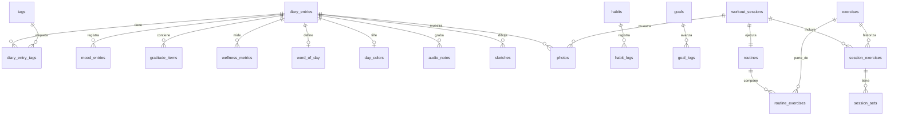

# 🗄️ Modelo de Datos · FitJournal

> Motor: **SQLite** (expo-sqlite, API async). Local-first, sin sincronización.
> Imágenes y audios: **filesystem** (rutas en tablas, binarios en disco).

---

## 1. Diagrama Entidad-Relación



---

## 2. Esquema completo (migración 001_init.sql)

```sql
PRAGMA foreign_keys = ON;

-- ============ DIARIO ============
CREATE TABLE diary_entries (
  id            INTEGER PRIMARY KEY AUTOINCREMENT,
  entry_date    TEXT NOT NULL UNIQUE,          -- 'YYYY-MM-DD' (una entrada por día)
  mood          INTEGER CHECK(mood BETWEEN 1 AND 5),
  energy        INTEGER CHECK(energy BETWEEN 1 AND 5),
  sleep_hours   REAL CHECK(sleep_hours >= 0 AND sleep_hours <= 24),
  body_weight   REAL,
  weather       TEXT,
  notes         TEXT,
  created_at    TEXT NOT NULL,                 -- ISO 8601
  updated_at    TEXT NOT NULL
);

CREATE TABLE tags (
  id   INTEGER PRIMARY KEY AUTOINCREMENT,
  name TEXT NOT NULL UNIQUE
);

CREATE TABLE diary_entry_tags (
  entry_id INTEGER NOT NULL REFERENCES diary_entries(id) ON DELETE CASCADE,
  tag_id   INTEGER NOT NULL REFERENCES tags(id) ON DELETE CASCADE,
  PRIMARY KEY (entry_id, tag_id)
);

CREATE TABLE mood_entries (
  id         INTEGER PRIMARY KEY AUTOINCREMENT,
  entry_id   INTEGER NOT NULL REFERENCES diary_entries(id) ON DELETE CASCADE,
  emotion    TEXT NOT NULL,                    -- rueda de emociones (p.ej. 'alegría','frustración')
  intensity  INTEGER NOT NULL CHECK(intensity BETWEEN 1 AND 5),
  context    TEXT                              -- 'trabajo'|'gym'|'familia'|...
);

CREATE TABLE gratitude_items (
  id         INTEGER PRIMARY KEY AUTOINCREMENT,
  entry_id   INTEGER NOT NULL REFERENCES diary_entries(id) ON DELETE CASCADE,
  text       TEXT NOT NULL CHECK(length(text) <= 500),
  created_at TEXT NOT NULL
);

CREATE TABLE wellness_metrics (
  id        INTEGER PRIMARY KEY AUTOINCREMENT,
  entry_id  INTEGER NOT NULL REFERENCES diary_entries(id) ON DELETE CASCADE,
  metric    TEXT NOT NULL,                     -- 'water'|'meditation'|'steps'|'reading'
  value     REAL,
  unit      TEXT
);

CREATE TABLE word_of_day (
  entry_id INTEGER PRIMARY KEY REFERENCES diary_entries(id) ON DELETE CASCADE,
  word     TEXT NOT NULL
);

CREATE TABLE day_colors (
  entry_id INTEGER PRIMARY KEY REFERENCES diary_entries(id) ON DELETE CASCADE,
  color    TEXT NOT NULL                       -- hex del mood color map (paleta cerrada del manual)
);

CREATE TABLE audio_notes (
  id         INTEGER PRIMARY KEY AUTOINCREMENT,
  entry_id   INTEGER NOT NULL REFERENCES diary_entries(id) ON DELETE CASCADE,
  file_path  TEXT NOT NULL,
  duration_s INTEGER,
  created_at TEXT NOT NULL
);

CREATE TABLE sketches (
  id         INTEGER PRIMARY KEY AUTOINCREMENT,
  entry_id   INTEGER NOT NULL REFERENCES diary_entries(id) ON DELETE CASCADE,
  strokes    TEXT NOT NULL,                    -- JSON vectorial [{x,y,p}...]
  image_path TEXT,                             -- render PNG opcional
  created_at TEXT NOT NULL
);

-- ============ HÁBITOS Y METAS ============
CREATE TABLE habits (
  id         INTEGER PRIMARY KEY AUTOINCREMENT,
  name       TEXT NOT NULL,
  icon       TEXT,
  color      TEXT,
  is_active  INTEGER NOT NULL DEFAULT 1,
  created_at TEXT NOT NULL
);

CREATE TABLE habit_logs (
  id       INTEGER PRIMARY KEY AUTOINCREMENT,
  habit_id INTEGER NOT NULL REFERENCES habits(id) ON DELETE CASCADE,
  log_date TEXT NOT NULL,
  done     INTEGER NOT NULL DEFAULT 0,
  UNIQUE(habit_id, log_date)
);

CREATE TABLE goals (
  id          INTEGER PRIMARY KEY AUTOINCREMENT,
  title       TEXT NOT NULL,
  target_date TEXT,
  progress    REAL NOT NULL DEFAULT 0,
  status      TEXT NOT NULL DEFAULT 'active',  -- 'active'|'done'|'archived'
  created_at  TEXT NOT NULL
);

CREATE TABLE goal_logs (
  id       INTEGER PRIMARY KEY AUTOINCREMENT,
  goal_id  INTEGER NOT NULL REFERENCES goals(id) ON DELETE CASCADE,
  log_date TEXT NOT NULL,
  note     TEXT
);

-- ============ PLANTILLAS GUIADAS ============
CREATE TABLE journal_templates (
  id         INTEGER PRIMARY KEY AUTOINCREMENT,
  name       TEXT NOT NULL,
  questions  TEXT NOT NULL,                    -- JSON array de preguntas
  is_builtin INTEGER NOT NULL DEFAULT 0,
  created_at TEXT NOT NULL
);

CREATE TABLE journal_prompts (
  id    INTEGER PRIMARY KEY AUTOINCREMENT,
  text  TEXT NOT NULL,
  theme TEXT
);

-- ============ GIMNASIO ============
CREATE TABLE exercises (
  id               INTEGER PRIMARY KEY AUTOINCREMENT,
  name             TEXT NOT NULL,
  muscle_primary   TEXT NOT NULL,
  muscle_secondary TEXT,
  equipment        TEXT,
  type             TEXT,                       -- 'compuesto'|'aislamiento'
  instructions     TEXT,
  is_custom        INTEGER NOT NULL DEFAULT 0,
  is_archived      INTEGER NOT NULL DEFAULT 0
);

CREATE TABLE routines (
  id          INTEGER PRIMARY KEY AUTOINCREMENT,
  name        TEXT NOT NULL,
  description TEXT,
  is_archived INTEGER NOT NULL DEFAULT 0,
  created_at  TEXT NOT NULL,
  updated_at  TEXT NOT NULL
);

CREATE TABLE routine_exercises (
  id            INTEGER PRIMARY KEY AUTOINCREMENT,
  routine_id    INTEGER NOT NULL REFERENCES routines(id) ON DELETE CASCADE,
  exercise_id   INTEGER NOT NULL REFERENCES exercises(id),
  order_index   INTEGER NOT NULL,
  target_sets   INTEGER,
  target_reps   INTEGER,
  target_weight REAL,
  rest_seconds  INTEGER,
  notes         TEXT
);

CREATE TABLE workout_sessions (
  id           INTEGER PRIMARY KEY AUTOINCREMENT,
  routine_id   INTEGER REFERENCES routines(id),
  session_date TEXT NOT NULL,                  -- 'YYYY-MM-DD' → enlaza con diary_entries
  started_at   TEXT,
  finished_at  TEXT,
  duration_min INTEGER,
  notes        TEXT,
  created_at   TEXT NOT NULL
);

CREATE TABLE session_exercises (
  id          INTEGER PRIMARY KEY AUTOINCREMENT,
  session_id  INTEGER NOT NULL REFERENCES workout_sessions(id) ON DELETE CASCADE,
  exercise_id INTEGER NOT NULL REFERENCES exercises(id),
  order_index INTEGER NOT NULL,
  notes       TEXT
);

CREATE TABLE session_sets (
  id                  INTEGER PRIMARY KEY AUTOINCREMENT,
  session_exercise_id INTEGER NOT NULL REFERENCES session_exercises(id) ON DELETE CASCADE,
  set_number          INTEGER NOT NULL,
  weight              REAL,
  reps                INTEGER,
  rpe                 REAL CHECK(rpe >= 1 AND rpe <= 10),
  is_completed        INTEGER NOT NULL DEFAULT 0,
  is_pr               INTEGER NOT NULL DEFAULT 0,
  rest_seconds        INTEGER
);

-- ============ FOTOS (filesystem + metadatos) ============
CREATE TABLE photos (
  id         INTEGER PRIMARY KEY AUTOINCREMENT,
  owner_type TEXT NOT NULL CHECK(owner_type IN ('diary','session')),
  owner_id   INTEGER NOT NULL,
  file_path  TEXT NOT NULL,
  thumb_path TEXT,
  width      INTEGER,
  height     INTEGER,
  created_at TEXT NOT NULL
);

-- ============ SISTEMA ============
CREATE TABLE settings (
  key   TEXT PRIMARY KEY,
  value TEXT
);

-- ============ ÍNDICES ============
CREATE INDEX idx_photos_owner       ON photos(owner_type, owner_id);
CREATE INDEX idx_sessions_date      ON workout_sessions(session_date);
CREATE INDEX idx_session_ex         ON session_exercises(session_id);
CREATE INDEX idx_session_sets_ex    ON session_sets(session_exercise_id);
CREATE INDEX idx_routine_ex_routine ON routine_exercises(routine_id);
CREATE INDEX idx_habit_logs         ON habit_logs(habit_id, log_date);
CREATE INDEX idx_mood_entries       ON mood_entries(entry_id);

-- ============ BÚSQUEDA FULL-TEXT ============
CREATE VIRTUAL TABLE diary_fts USING fts5(
  notes,
  content='diary_entries',
  content_rowid='id'
);
CREATE VIRTUAL TABLE exercises_fts USING fts5(
  name, muscle_primary, instructions,
  content='exercises',
  content_rowid='id'
);

-- Triggers para mantener FTS sincronizado
CREATE TRIGGER diary_ai AFTER INSERT ON diary_entries BEGIN
  INSERT INTO diary_fts(rowid, notes) VALUES (new.id, new.notes);
END;
CREATE TRIGGER diary_ad AFTER DELETE ON diary_entries BEGIN
  INSERT INTO diary_fts(diary_fts, rowid, notes) VALUES ('delete', old.id, old.notes);
END;
CREATE TRIGGER diary_au AFTER UPDATE ON diary_entries BEGIN
  INSERT INTO diary_fts(diary_fts, rowid, notes) VALUES ('delete', old.id, old.notes);
  INSERT INTO diary_fts(rowid, notes) VALUES (new.id, new.notes);
END;
```

---

## 3. Pragmas (apertura de base de datos)

```ts
await db.execAsync(`
  PRAGMA journal_mode = WAL;
  PRAGMA foreign_keys = ON;
  PRAGMA synchronous = NORMAL;
`);
```

---

## 4. Estrategia de migraciones

1. `PRAGMA user_version` guarda el número de migración aplicada.
2. Los scripts viven en `src/core/db/migrations/NNN_nombre.sql`.
3. `migrator.ts` aplica en orden los scripts con `version > user_version` dentro de transacción y actualiza `user_version`.
4. **Prohibido** editar un script ya aplicado: siempre crear `NNN+1`.
5. Al abrir: verificación opcional `PRAGMA integrity_check` (recomendada mensual o tras import).

---

## 5. Seed — biblioteca de ejercicios

`src/core/db/seed/exercises.json`: array de ~80-120 ejercicios precargados (push/pull/legs/full body, fuerza e hipertrofia) con `name`, `muscle_primary`, `muscle_secondary`, `equipment`, `type`, `instructions`. Se insertan en el **primer arranque** (cuando `settings['seed_version']` no existe).

---

## 6. Diccionario de datos (tablas clave)

| Tabla | Campos | Reglas |
|---|---|---|
| `diary_entries` | `entry_date` UNIQUE 'YYYY-MM-DD'; mood/energy 1-5; sleep 0-24 | UPSERT por fecha |
| `mood_entries` | emotion (rueda), intensity 1-5, context | múltiples por día |
| `wellness_metrics` | metric ∈ {water, meditation, steps, reading} | valor numérico + unidad |
| `photos` | owner_type ∈ {diary, session}; rutas en filesystem | borrar dueño ⇒ borrar archivos |
| `exercises` | muscle_primary obligatorio; is_custom | seed + usuario |
| `routines` | compuestas por routine_exercises ordenadas | archivar no borrar |
| `workout_sessions` | session_date enlaza con diary del día | 1 sesión activa a la vez |
| `session_sets` | rpe 1-10; is_pr detectado en repositorio | persistencia incremental |
| `settings` | key-valor (tema, cifrado, onboarding) | todo exportable |

---

## 7. Consultas de ejemplo

**Detección de PR** (mejor peso×reps del mismo ejercicio, en repositorio):

```sql
SELECT MAX(weight * reps) FROM session_sets ss
JOIN session_exercises se ON ss.session_exercise_id = se.id
WHERE se.exercise_id = ? AND ss.is_completed = 1;
```

**Racha de hábito:**

```sql
SELECT log_date FROM habit_logs
WHERE habit_id = ? AND done = 1
ORDER BY log_date DESC;
```

**Vista "Hoy" (unificación diario + gym):**

```sql
SELECT de.*, ws.id AS session_id FROM diary_entries de
LEFT JOIN workout_sessions ws ON ws.session_date = de.entry_date
WHERE de.entry_date = ?;
```
