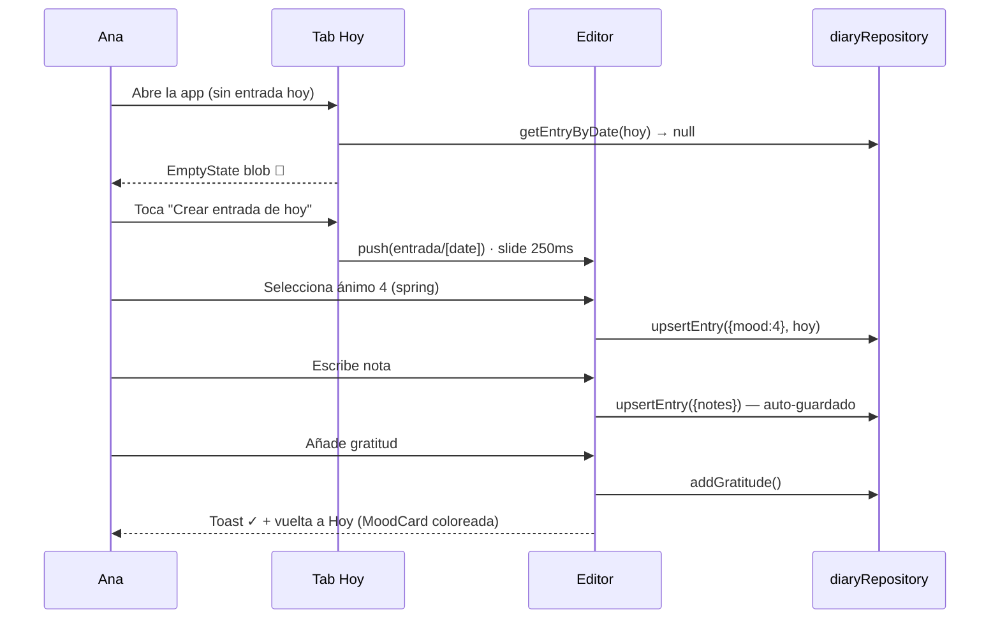
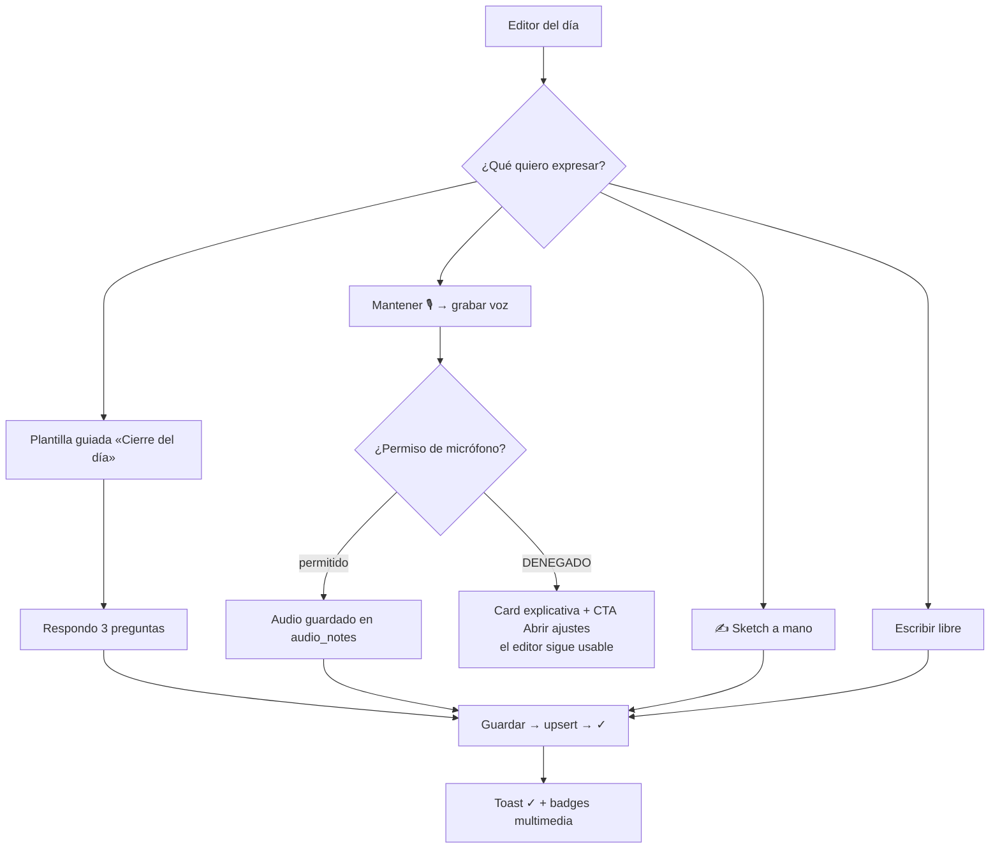
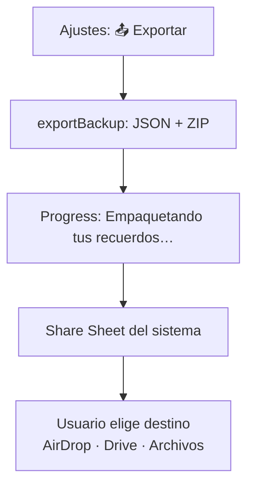
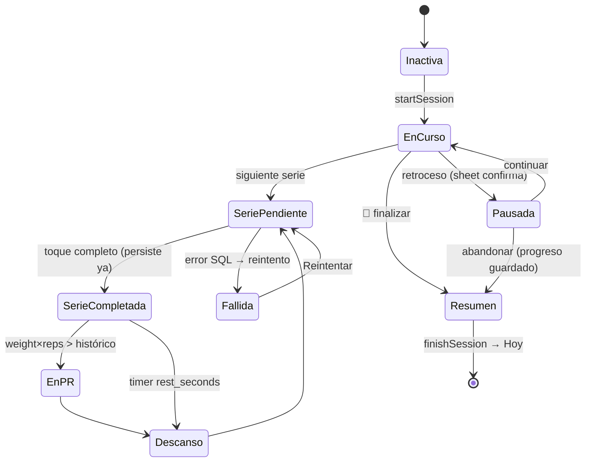

# 🎬 Flujos de Usuario · FitJournal

> Happy paths y flujos alternativos/borde. Simulación jugable: `../Flujos/FLUJOS_VISUAL.html`

---

## 1. F1 — Registrar el día (HU-01) · Ana



**Ramas:**
- Sueño fuera de rango → Zod rechaza → **Toast** error → corrige.
- Salir con cambios → **Sheet** descartar/guardar.

---

## 2. F2 — Entrenamiento completo (HU-02/03/04) · Marcos

```mermaid
flowchart TD
    A[GymCard: ▶ Empezar sesión] --> B[startSession]
    B --> C{¿sesión activa ya?}
    C -- sí --> D[Toast CONFLICT → continuar existente]
    C -- no --> E[Ejercicio activo]
    E --> F[Veo "Última vez: 80kg×5"]
    F --> G[Ajusto Stepper ±2.5kg]
    G --> H[Completo serie → check spring]
    H --> I[completeSet() persiste YA]
    I --> J{¿nuevo récord?}
    J -- sí --> K[is_pr=1 · Badge 🏆 · Toast PR]
    J -- no --> L[Timer descanso]
    K --> L
    L --> H
    H --> M[🏁 Finalizar → Sheet resumen]
    M --> N[finishSession → Hoy]
    I -.fallo SQL.-> O[Serie ✗ no guardada → Reintentar]
    H -.retroceso.-> P[Sheet: ¿Abandonar?<br/>Tu progreso queda guardado]
```

**Garantía:** cada serie se persiste al instante → un crash o abandono **no pierde** lo entrenado.

---

## 3. F3 — Diario creativo (HU-05/09/14/15) · Lucía



---

## 4. F4 — Exportar respaldo (HU-16)



---

## 5. Flujos alternativos y de borde

| # | Caso | Disparador | Comportamiento |
|---|---|---|---|
| B1 | **Validación fallida** | Sueño = 30 | Zod rechaza → Toast `VALIDATION` + campo marcado; nada se escribe |
| B2 | **Permiso denegado** | 🎙️ sin permiso | Card + CTA "Abrir ajustes"; editor usable sin voz |
| B3 | **Storage full** | Foto sin espacio | Toast `STORAGE_FULL` + sugerencia de liberar |
| B4 | **Conflicto de sesión** | 2ª sesión activa | Toast `CONFLICT` → continuar la existente |
| B5 | **Fallo de escritura** | Error SQL en serie | Serie "✗ no guardada" + **Reintentar** (el resto intacto) |
| B6 | **Cancelación de sesión** | Retroceso a mitad | Sheet *"¿Abandonar? Tu progreso queda guardado"* |
| B7 | **Cancelación de edición** | Salir sin guardar | Sheet descartar/guardar |
| B8 | **DB corrupta al arrancar** | integrity_check falla | Pantalla de error + "Reintentar" + acceso a importar respaldo |
| B9 | **Import inválido** | JSON que falla Zod | Rechazo **antes** de tocar la DB + informe de errores |
| B10 | **Recordatorio** | Notificación 21:00 | Deep link directo al Editor del día |

---

## 6. Diagrama de estados de la sesión de gym (HU-02)



---

## 7. Garantías transversales de flujo

1. **Ningún error bloquea el camino principal** — toda rama de error ofrece salida (reintento, guía, cancelación segura).
2. **Nunca se pierde trabajo del usuario** — persistencia incremental (series) y auto-guardado (diario).
3. **Confirmaciones solo en acciones destructivas** — borrar datos, abandonar sesión, descartar edición.
4. **Máximo 3 taps** de vuelta al "Hoy" desde cualquier punto.
5. **Feedback siempre visible** — todo cambio de estado tiene spring, toast o check.
